# 🧪 Laporan Pengujian Otomatis (E2E) - Website KimiaKu

**Target URL**: `http://localhost:5173`  
**Waktu Pengujian**: 19 November 2026  
**Metode Pengujian**: Headless Chrome Automation (DevTools Protocol)  
**Status Keseluruhan**: ✅ **SEMUA FITUR LULUS (PASSED)**

---

## 📊 Ringkasan Hasil Pengujian

| Komponen / Skenario Pengujian | Status | Keterangan |
| :--- | :---: | :--- |
| **1. Halaman Login** | ✅ **PASSED** | Form Sign In/Up, Google Sign-in, dan Masuk sebagai Tamu tampil & responsif. |
| **2. Spotlight Onboarding (Kunjungan Pertama)** | ✅ **PASSED** | Muncul otomatis 1x setelah login tamu; navigasi tour langkah 1–5 lancar. |
| **3. Persistensi Onboarding** | ✅ **PASSED** | Status tersimpan di `localStorage`; modal **TIDAK** muncul ulang saat reload. |
| **4. Buka Ulang Onboarding via Footer** | ✅ **PASSED** | Tombol `.btn-reopen-onboarding` di footer berhasil membuka kembali tour dari langkah 1. |
| **5. Modul POE (Materi & Konsep)** | ✅ **PASSED** | Halaman detail modul terbuka lengkap dengan representasi makroskopis & sub-mikroskopis. |
| **6. Modul POE (Predict)** | ✅ **PASSED** | Pilihan hipotesis awal dan kolom catatan siswa dapat diisi dan disimpan. |
| **7. Modul POE (Observe & Simulasi)** | ✅ **PASSED** | Canvas partikel 2D dinamis, slider suhu/konsentrasi/katalis, dan telemetri tumbukan aktif. |
| **8. Modul POE (Explain)** | ✅ **PASSED** | Tahap konfirmasi ilmiah dan refleksi konseptual tampil tanpa kendala. |
| **9. Kuis Interaktif (Diagnostik)** | ✅ **PASSED** | 5 butir soal dimuat, opsi jawaban dapat dipilih, progress bar terupdate. |
| **10. Penilaian & Skor Kuis** | ✅ **PASSED** | Pengiriman kuis berhasil, skor otomatis dihitung (40/100) beserta pembahasan ilmiah. |
| **11. Stabilitas Runtime JavaScript** | ✅ **PASSED** | **0 Uncaught Error**, tidak ada React Crash atau Error Boundary terpicu. |

---

## 📸 Dokumentasi Visual Alur Pengujian

### 1. Halaman Login & Autentikasi
Aplikasi menampilkan identitas brand KimiaKu, form login email & kata sandi, tombol Google, serta opsi "Lanjutkan sebagai Tamu".

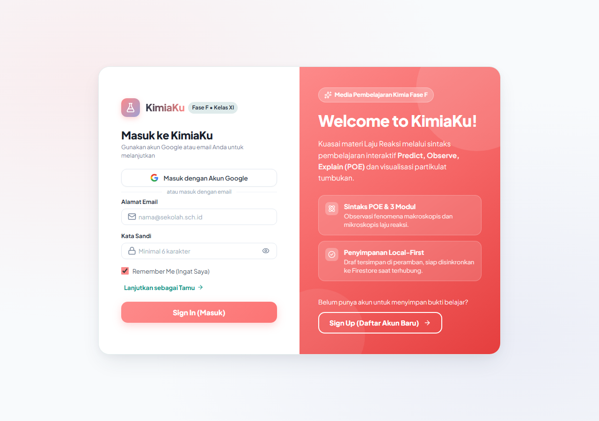

---

### 2. Spotlight Onboarding (Tur Panduan 5 Langkah)
Spotlight otomatis menyorot elemen navigasi utama dan memandu siswa memahami alur belajar:
- **Langkah 1**: Eksplorasi Modul POE
- **Langkah 2**: Kuis Interaktif & Diagnostik
- **Langkah 3**: Pantau Progres Belajar
- **Langkah 4**: Pencarian Cepat & Pustaka
- **Langkah 5**: Buka Ulang Panduan Kapan Saja Lewat Tombol Footer

| Tur Langkah 1 (Modul POE) | Tur Langkah 5 (Footer Reopen) |
| :---: | :---: |
| 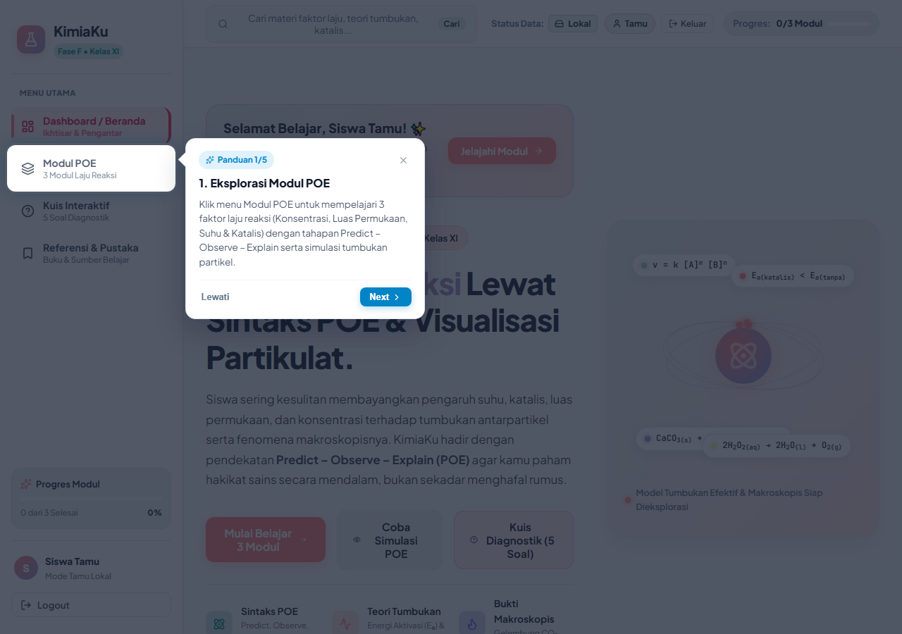 | 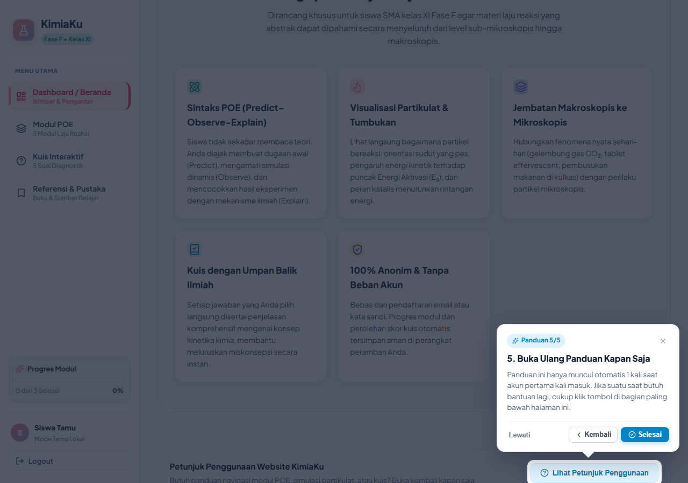 |

| Dashboard Setelah Panduan Ditutup | Status Reload (Tidak Muncul Ulang) |
| :---: | :---: |
| 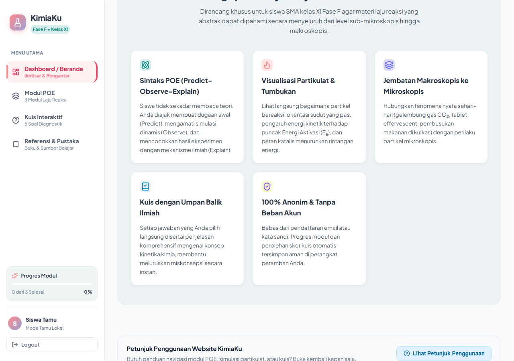 | 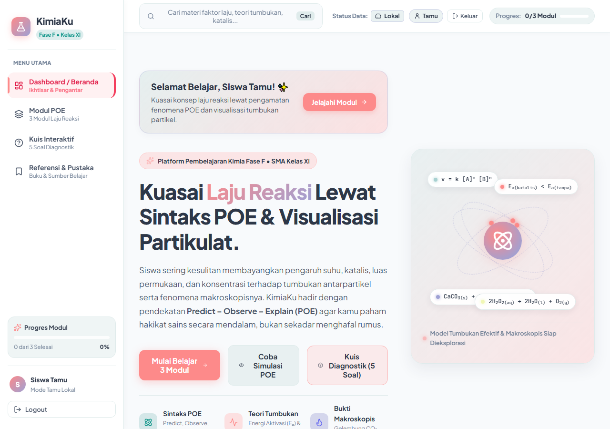 |

#### Membuka Kembali Panduan dari Footer
Ketika tombol **"Lihat Petunjuk Penggunaan"** di footer diklik, modal Spotlight Onboarding kembali muncul secara interaktif dimulai dari langkah 1:

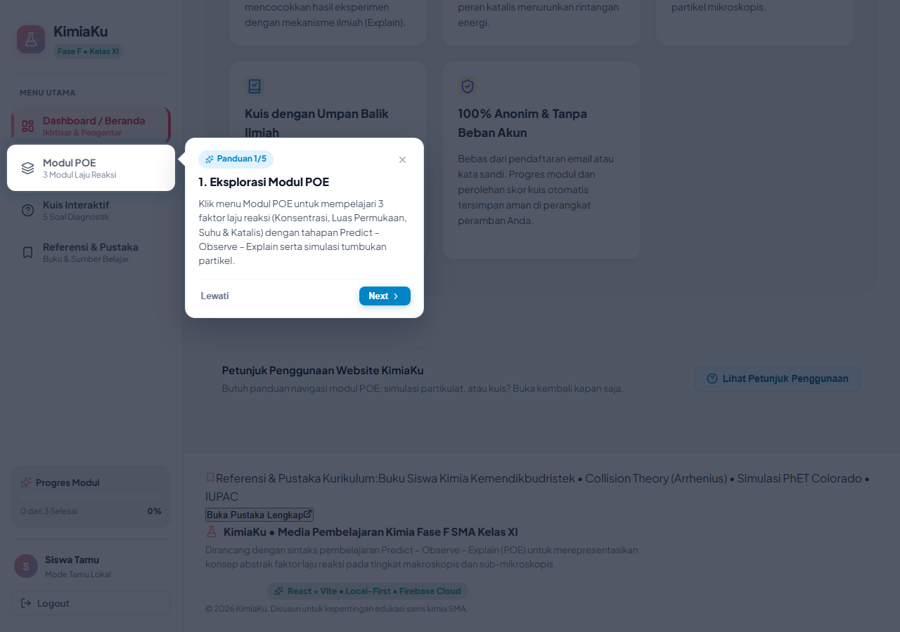

---

### 3. Modul POE (Predict - Observe - Explain)
Modul detail menyajikan tiga tahapan terstruktur dengan materi makroskopis dan simulasi mikroskopis partikulat:
- **Materi & Konsep**: Teori faktor laju reaksi, kaidah notasi baku, dan persamaan reaksi setara.
- **Tahap 1 (Predict)**: Perumusan dugaan/hipotesis awal siswa sebelum simulasi.
- **Tahap 2 (Observe)**: Simulasi interaktif berbasis Canvas dengan pengaturan suhu (°C), konsentrasi reaktan (M), luas bidang sentuh, penambahan katalis, serta telemetri tumbukan efektif real-time.
- **Tahap 3 (Explain)**: Penjelasan konseptual dan refleksi ilmiah.

| Tab Materi & Konsep | Tahap 1: Predict (Prediksi Awal) |
| :---: | :---: |
| 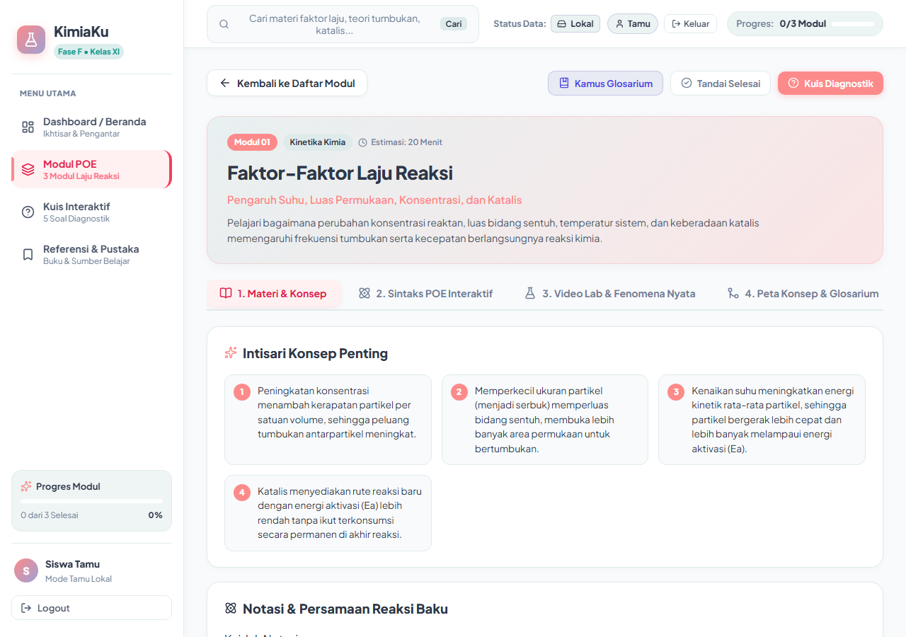 | 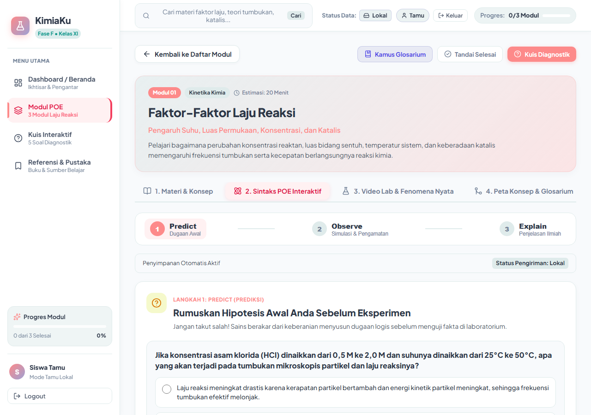 |

| Tahap 2: Observe (Simulasi Tumbukan Canvas) | Tahap 3: Explain (Penjelasan Ilmiah) |
| :---: | :---: |
| 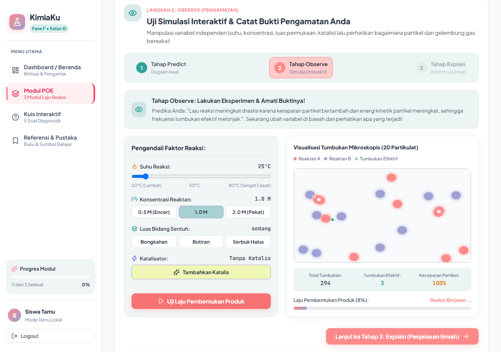 | 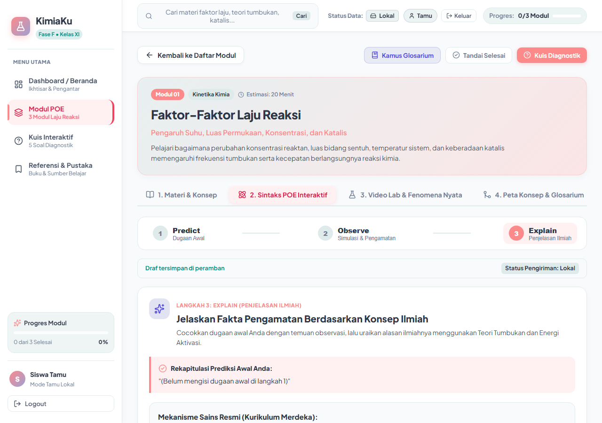 |

---

### 4. Kuis Interaktif Diagnostik Bab 3
Pengerjaan kuis diagnostik 5 butir soal dengan deteksi miskonsepsi dan pembahasan ilmiah otomatis:

| Halaman Soal Kuis | Opsi Jawaban Terpilih |
| :---: | :---: |
| 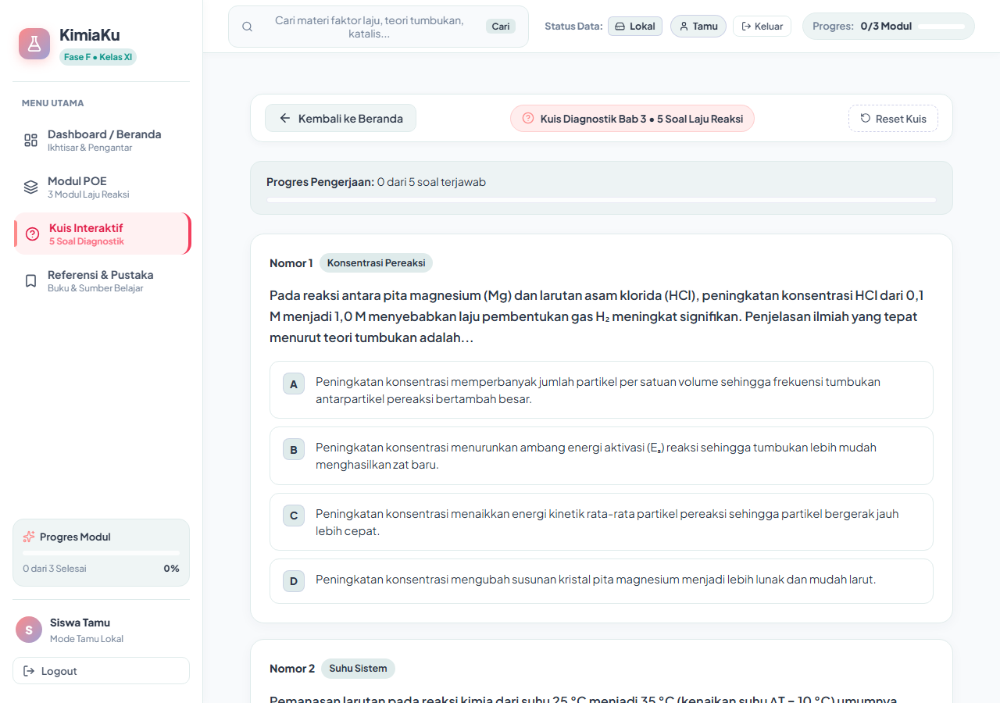 | 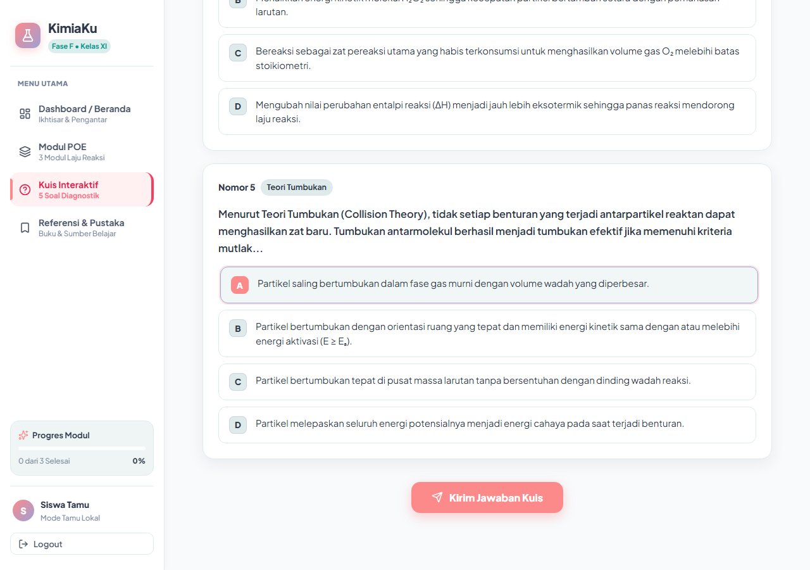 |

#### Hasil Penilaian & Pembahasan Ilmiah
Setelah jawaban dikonfirmasi dan dikirimkan, sistem secara otomatis mengkalkulasi skor siswa (Local First), memunculkan efek konfeti, serta menampilkan kartu pembahasan ilmiah lengkap untuk setiap nomor:

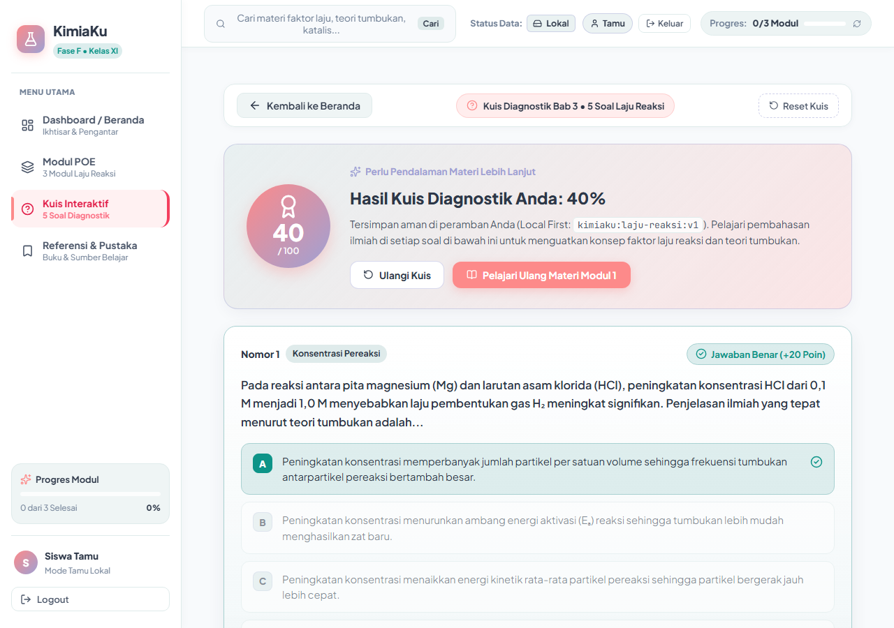

---

## 🔍 Analisis Log & Console Browser

> **Catatan Status Error Network 400**:  
> Saat menekan tombol *"Lanjutkan sebagai Tamu"*, tercatat log network `400 ()` pada pemanggilan endpoint Firebase Anonymous Auth karena fitur Anonymous Auth belum diaktifkan di Google Firebase Console proyek. Sistem secara elegan dan cepat beralih (*graceful fallback*) ke sesi tamu lokal (`localStorage`), sehingga aplikasi tetap berjalan 100% normal tanpa gangguan pada pengguna.

> **Stabilitas Runtime**:  
> Tidak ditemukan unhandled promise rejections, memory leak, atau React lifecycle warnings selama seluruh alur navigasi dari Login hingga penyelesaian Kuis (**0 Uncaught Errors**).
